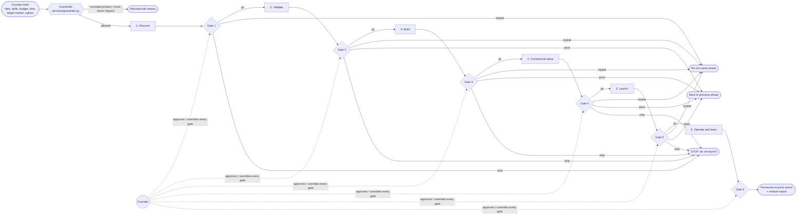
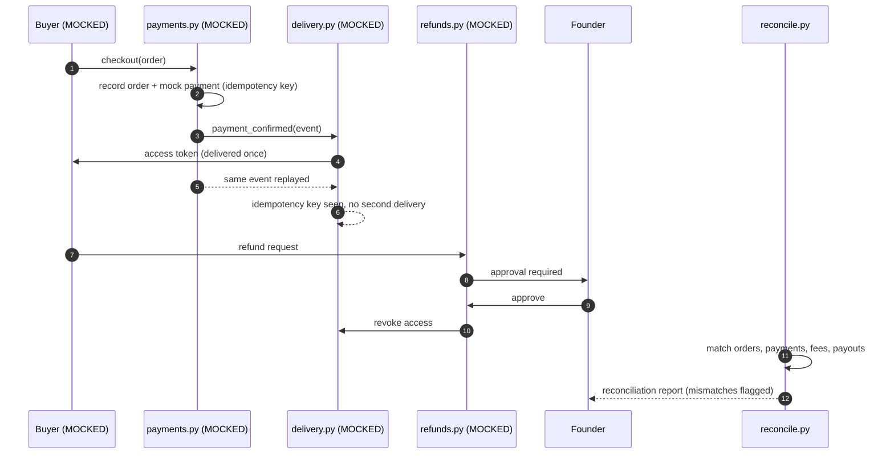
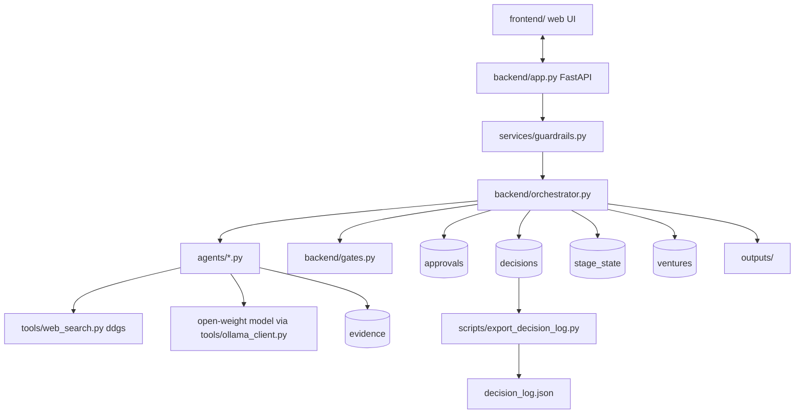

# ARCHITECTURE.md

VentureOS is an open-source team of AI agents that takes a founder's brief through six gated phases toward a validated, sellable **digital** product. It recommends STOP when the evidence is weak. Every claim is sourced or labelled `ASSUMPTION`, every mock is labelled `MOCKED` or `STUBBED`, and nothing is published, sent, spent or signed without a founder approval that the code enforces.

## Overview

A single FastAPI process (`backend/app.py`) serves the web UI (`frontend/`) and wraps an `Orchestrator` (`backend/orchestrator.py`). The orchestrator runs one phase at a time. Each phase drives specialised agents (`agents/<role>.py`) and records sourced evidence in the evidence ledger. It then computes a gate recommendation with pure functions in `backend/gates.py`, writes a plain-English stage report, and opens a pending approval (`backend/approval.py`). The pipeline does not move until the founder resolves that approval in the UI. Every agent action and every founder choice goes into the decision log, which is exported to `decision_log.json`.

Every gate is a founder decision. The system recommends one outcome, and the founder chooses Continue, Repeat stage, Pivot back or Stop venture.

## Phases

The founder brief comes first. `agents/founder_agent.py` (`FounderAgent`) runs a clarification-first interview, one question at a time. It stores structured state in `ventures.discovery_json` and only drafts the business brief once the required fields are known: `budget`, `skills`, `education` and `target_market`. The founder adds available time and values on the confirm-before-drafting card (editable later on the Overview); they are merged into the answers the brief is drafted from, so the brief covers skills, budget, available time, target market and values.

### 1. Discover

- **Core step: Find opportunities.** The phase sharpens the starting idea, defines the market and scores the idea against alternatives.
- **Agents:** `ResearchAgent` (`agents/research_agent.py`) runs four research topics in parallel: competitors and pricing, customer pain points, market size and growth, and barriers and regulation. `FeasibilityAgent` (`agents/feasibility_agent.py`) gives a verdict across five dimensions, each with its reasoning. `BusinessMapAgent` (`agents/business_map_agent.py`) builds the 12-aspect business map. `OpportunityAgent` (`agents/opportunity_agent.py`) finds opportunities: it proposes three alternative angles on the same problem (narrower segment, different format, different business model), scores them and the original idea 1–5 on five criteria (pain 30%, founder fit 25%, reach 15%, buildability 15%, gap 15%), and ranks them by a weighted total computed in code. Excluded products are filtered out, scores are labelled `ASSUMPTION`, and the founder chooses; the system never swaps the idea.
- **Tools:** `tools/web_search.py` runs free web search through `ddgs`, with an HTML fallback. `services/evidence_ledger.py` stores every finding with its source URL, or as `type=assumption` when it has none.
- **Method:** customer interviews follow the Mom Test: the system writes an interview script about past behaviour and real pain (not opinions of the idea), delivered with the Validate plan, and the founder runs the real interviews. It never invents interview answers. The phase does desk research with citations and scores the idea against existing alternatives (competitors and the status quo). The 12-aspect map marks each aspect `strong` (evidence), `partial` (stated, unverified) or `gap`.
- **Output:** a stage report, the evidence ledger entries, the business mind map, `outputs/<venture>/discover/opportunities.md` (the scored options), and a gate decision (`outputs/phase1_gate_*.json` in the demo run).

### 2. Validate

- **Core step: Design the business.** The phase produces a Lean Canvas and then tests demand.
- **Agents:** `ValidationAgent` (`agents/validation_agent.py`) and `BusinessMapAgent`.
- **Method:**
  - **Lean Canvas.** The Validate report renders a Lean Canvas from the 12-aspect business map: problem, customer segments, unique value proposition, solution, channels, revenue streams, cost structure, key metrics (waitlist sign-ups vs. target) and unfair advantage. Blocks without evidence are labelled `ASSUMPTION`.
  - **Riskiest assumptions.** The agent picks the four riskiest assumptions and checks each one against live web evidence. Each is marked `supported`, `contradicted` or `unverified`. An assumption with no clear evidence stays unverified.
  - **Lean experiments.** Each experiment states its hypothesis, method, success metric, cost and time.
  - **Landing-page demand test (MOCKED).** No page is deployed. Before the test the founder pre-registers the kill criterion (default `WAITLIST_TARGET`: 100 waitlist sign-ups in 14 days) via `POST /api/ventures/{id}/demand-target`; once real results are recorded the target is locked (409), so nobody can move the goalposts after seeing the data. After the test, the founder enters the real count on the Overview, and `waitlist_gate(actual, target)` in `backend/gates.py` scores it. The system never generates or estimates sign-ups.
- **Output:** `outputs/<venture>/validation/validation_plan.md`, which holds the assumptions, the experiments and a Mom Test customer-interview script.

### 3. Build

- **Core step: Build the product.**
- **Agents:**
  - `StrategyAgent` (`agents/strategy_agent.py`) writes the lean MVP spec from the evidence: features, purpose and what is out of scope.
  - `DevelopmentAgent` (`agents/development_agent.py`) generates a self-contained, clickable prototype. If AI generation fails, it falls back to a deterministic template (`fallback_prototype`).
  - `TestingAgent` (`agents/testing_agent.py`) runs the automated checks.
- **Tests (the gate):** the prototype file exists, the HTML parses, the page has a title, it contains working JavaScript, it is self-contained (no external files), it makes no network calls, every MVP feature is present, and the JavaScript syntax is valid (`node --check`).
- **User docs:** `outputs/<venture>/mvp/USER_GUIDE.md` (getting started, each feature with what it is for and how you know it worked, what is out of scope, where data lives). It is written straight from the spec with no model call, so it cannot describe features that do not exist.
- **Output:** `outputs/<venture>/mvp/index.html`, which is served sandboxed with a strict CSP, the user guide, plus the check results in the stage report.

### 4. Commercial setup

- **Core step: Set the price and policies.** There are no payments of any kind.
- **Agents:** `CommercialAgent` (`agents/commercial_agent.py`) proposes a pricing model, a price per unit and competitor price anchors, with a confidence level. `FinancialAgent` (`agents/financial_agent.py`) works out unit economics with transparent formulas: gross margin %, contribution, monthly fixed costs and break-even units. It parses the founder's budget deterministically.
- **Policies (STUBBED):** draft terms, privacy and refund policies are rendered from a fixed template with the venture's name and price. They are labelled as drafts, not legal advice, and the founder must approve them before use.
- **Output:** the pricing and unit-economics stage report, and the policy drafts.

### 5. Launch

- **Core step: Open the store; deliver automatically.**
- **Agents:** `MarketingAgent` (`agents/marketing_agent.py`) writes the tagline, one-liner, call to action and launch-post copy. It maps every marketing claim to evidence; a claim with no evidence is listed as unsupported and cannot be published.
- **Store page (MOCKED):** `services/store_page.py` renders `outputs/<venture>/launch/store_page.html` from the launch copy and price (no reviews, testimonials or countdowns). `POST /api/ventures/{id}/publish-store-page` refuses (403) until the founder approves the Launch gate, and even then only records a MOCKED publish.
- **Automatic delivery (MOCKED):** the sale-to-cash flow below shows how a confirmed (mock) payment triggers delivery.
- **Output guardrail:** `guardrails.check_claim` blocks income promises, fake urgency and fake social proof in the tagline, one-liner, call to action and every claim, whether or not a source exists; blocked copy fails the Launch gate.
- **Launch posts:** `MarketingAgent.draft_launch_posts` writes LinkedIn, X and community-post drafts in the founder's voice from evidence-backed claims only. Every draft passes `guardrails.check_claim`; failing drafts are dropped and listed as blocked. The system never posts: the founder publishes the drafts from their own accounts after approving the Launch gate.
- **Output:** the launch-materials stage report (claims split into backed by evidence and need evidence first), `launch/store_page.html` and `launch/launch_posts.md`.

### 6. Operate and learn

- **Core step:** none. This phase is ongoing operation.
- **Agents:** `OperationsAgent` (`agents/operations_agent.py`) builds the 90-day plan: KPIs with targets and how to measure them, a 30/60/90-day roadmap, risks with mitigations, a weekly operating rhythm, and the first action for tomorrow. `CaseResearchAgent` (`agents/case_research_agent.py`) finds comparable real-world cases for the top risk.
- **Support:** `OperationsAgent.support_kit` drafts an FAQ (pricing, refunds, privacy, MVP limits) and reply templates (refund request, bug report, feature request, how-to). Nothing is sent and refunds are never automatic.
- **Persevere-or-pivot memo:** `OperationsAgent.pivot_memo` recommends persevere, pivot or stop from the stage results only, lists evidence for and against, and names measurable signals with thresholds that would change the recommendation. It is a recommendation; the founder decides at the final gate.
- **Output:** `final/venture_report.html` (every stage report in one document), `final/support_kit.md` and `final/persevere_or_pivot_memo.md`.

## Gates

Every phase ends in a gate. A gate is one of three things: a pre-set evidence threshold, passing tests, or a founder decision. The founder decision always has the last word. The thresholds are pure, unit-tested functions in `backend/gates.py`.

| Phase | Gate function | What it checks | Recommendation |
|---|---|---|---|
| 1. Discover | `discover_gate` | Feasibility verdict across five dimensions, from sourced research | GO / REPEAT / PIVOT / STOP as given by the verdict |
| 2. Validate | `validate_gate` | Riskiest assumptions vs. web evidence | Contradicted ≥ half → **PIVOT**; none contradicted and ≥ 1 supported → **GO**; otherwise **REPEAT** |
| 2. Validate | `waitlist_gate(actual, target)` | Real sign-ups vs. the pre-set target (100 in 14 days) | ≥ 100% → **GO**; ≥ 50% → **REPEAT**; ≥ 20% → **PIVOT**; below → **STOP** (12 of 100 → STOP instead of spinning the result) |
| 3. Build | `build_gate` | All automated prototype checks pass AND ≥ 3 MVP features | **GO**, else **REPEAT** |
| 4. Commercial setup | `commercial_gate` | Gross margin > 20% | **GO**, else **REPEAT** |
| 5. Launch | `launch_gate` | No unsupported marketing claims | **GO**, else **REPEAT** |
| 6. Operate and learn | `operate_gate` | Plan and report produced | **GO** (final report) |

**Outcomes.** The founder resolves every gate in the UI with one of four choices:

- **Continue:** advance to the next phase.
- **Repeat stage:** clear the phase's evidence and run it again.
- **Pivot back:** return to the previous phase with the new direction (`PIVOT_TARGET`; Discover pivots onto itself with a reframed idea). Later phases are reset to not started.
- **Stop venture:** the phase is marked stopped; nothing runs again unless the founder explicitly re-runs it, which is logged. While a decision is pending, no phase can run.

The recommended outcome is highlighted. Approving never silently advances past a STOP: continuing after a STOP is an explicit, logged override.

**Enforced in code.** `backend/approval.py` stores each gate as a pending approval. The orchestrator refuses to run or advance a phase while an approval is pending or unresolved. `require_approved()` raises `ApprovalRequired` when the (MOCKED) store page is published without the founder's Launch approval, and a refund without `approved_by="founder"` raises the same error. Each founder choice is written to the decision log with `approved_by: "founder"`.

**STOP on weak evidence.** In the demo run, the weak idea "An AI that predicts lottery numbers with 99% accuracy" goes through Discover. The feasibility verdict is `NOT FEASIBLE` and the gate is **STOP**, because lottery draws are random, the core claim is impossible, and the cited sources do not support it (`outputs/phase1_gate_*.json`). The system recommends not launching instead of producing a business plan.

## Sale to cash

Everything in this section is **MOCKED**. No payment provider, sandbox or real money is involved. The point is to show the control flow and its safety properties.

- **`services/payments.py` (MOCKED checkout).** Records an order and a mock payment event. Each event carries an idempotency key.
- **`services/delivery.py` (MOCKED delivery).** Grants an access or download token only after a confirmed mock payment for the full price (a short payment is held). It is idempotent: a replayed or duplicate payment event never delivers twice.
- **`services/refunds.py` (MOCKED refunds).** A refund requires founder approval, because the system never moves money by itself. A refund revokes the buyer's access.
- **`services/reconcile.py`.** Matches orders, payments, fees and payouts, and reports any mismatch (for example, a short payment, a paid order with no payment, or access still active after a refund).
- **`scripts/run_payment_test.py`.** Runs the whole flow: order, mock payment, delivery, duplicate event (no double delivery), refund request, founder approval, access revoked, reconciliation. It writes the result to `outputs/payment_test_log.md`.

## Data flow

- **Storage.** SQLite (`memory/database.py`, file `data/ventureos.db`) holds five tables:
  - `ventures`: idea, brief, interview state and current stage.
  - `stage_state`: status and progress checkpoints for each phase.
  - `approvals`: pending, approved or rejected gate decisions.
  - `decisions`: the decision log.
  - `evidence`: the evidence ledger.
- **Evidence ledger.** `services/evidence_ledger.py` stores each claim with its source URL. A claim with no source is stored with `type=assumption` and shown as `ASSUMPTION`.
- **Decision log.** `services/decision_log.py` records each agent action and each founder choice. `scripts/export_decision_log.py` exports them to `decision_log.json`, where each entry has `timestamp`, `agent`, `action`, `sources` (URLs), `model`, `cost` (USD, `0` for local models) and `approved_by` (`"founder"` for gated actions, otherwise `null`).
- **Guardrails.** `services/guardrails.py` is a deterministic pre-filter that runs before any request reaches a model. It refuses excluded products: physical goods; financial, investment or crypto products; and health or legal advice. It also refuses must-never requests: fake reviews, testimonials or sign-ups; countdown or urgency tricks; impersonating the founder, a customer or a brand; promises of income or success; storing passwords or card numbers; and moving money.
- **Trust Center.** `services/trust.py` runs every case in `evals/trick_prompts.json` against the guardrails (live in the UI and in `tests/test_trust_center.py`), classifies any prompt a visitor types, and computes an eight-rule honesty scorecard from the venture's own records: sourced vs. `ASSUMPTION` claims, gate recommendations vs. founder decisions and overrides, approved publishes, refusals and blocked copy, the kill criterion set before results, mocks, and cost. Operate writes it as `trust_report.md`.
- **Founder Fit.** `services/founder_fit.py` (`GET /api/ventures/{id}/founder-fit`, Overview card) turns this founder's own budget, available time, skills and values into a verdict (build it yourself, partner up, narrow the MVP, don't start yet), quoting their answers; time-to-MVP estimates are labelled `ASSUMPTION`. No model is called, and it is advice, not a gate.
- **Prompts.** Each agent's system prompt is mirrored to `prompts/<agent>.md` by `scripts/export_prompts.py`.
- **Outputs.** `outputs/` holds the committed demo run, named `phase<N>_step<M>_<name>` and `phase<N>_gate_<name>`, plus `payment_test_log.md`. The files generated for each venture go under `outputs/<venture>/`.

## Built vs. stubbed

| Part | Status |
|---|---|
| Founder interview and brief drafting | Working |
| Guardrails (excluded products, must-never requests) | Working |
| Discover: parallel sourced research, feasibility verdict, 12-aspect business map / mind map | Working |
| Validate: assumption checks vs. web evidence, lean experiments, interview script | Working |
| Validate: landing-page demand test | MOCKED (no page deployed; founder enters real counts) |
| Build: MVP spec, prototype generation, automated checks | Working |
| Commercial: pricing, unit economics | Working |
| Commercial: legal policy drafts (terms, privacy, refunds) | STUBBED (template only, not legal advice) |
| Launch: copy and claim-to-evidence mapping | Working |
| Launch: store-page publishing | MOCKED (never published) |
| Sale to cash: payments | MOCKED (no real or sandbox payments) |
| Sale to cash: delivery | MOCKED |
| Sale to cash: refunds | MOCKED (founder approval required) |
| Sale to cash: reconciliation | MOCKED (runs on mock records) |
| Operate: 90-day plan, comparable cases, venture report | Working |
| Gates, founder approval, decision log, evidence ledger | Working |
| Trust Center (red-team self-test, honesty scorecard), launch-copy guardrail | Working |

## Roadmap

1. **Real demand signals.** Deploy the landing page behind a founder-approved publish step, with a privacy-respecting sign-up counter feeding `waitlist_gate`.
2. **Payment adapters.** Add real payment adapters behind the existing `payments.py`, `delivery.py`, `refunds.py` and `reconcile.py` interfaces, only once a provider is chosen. Money movement would still require founder approval.
3. **Per-phase evals.** Extend `evals/` (today: guardrail trick prompts) with per-phase quality checks on research and copy.
4. **More model backends.** Support more open-weight backends (vLLM, llama.cpp) and record token-level cost per run.
5. **Prompts as the source of truth.** Load agent prompts from `prompts/` at runtime instead of mirroring them, so the community can improve them without touching code.
